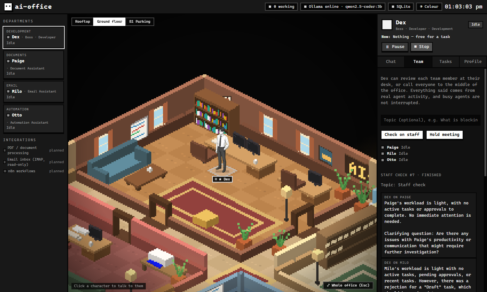
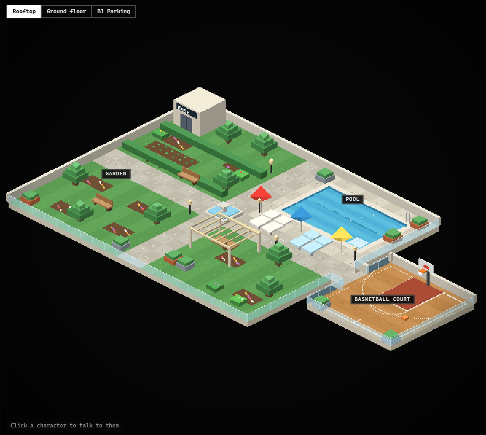
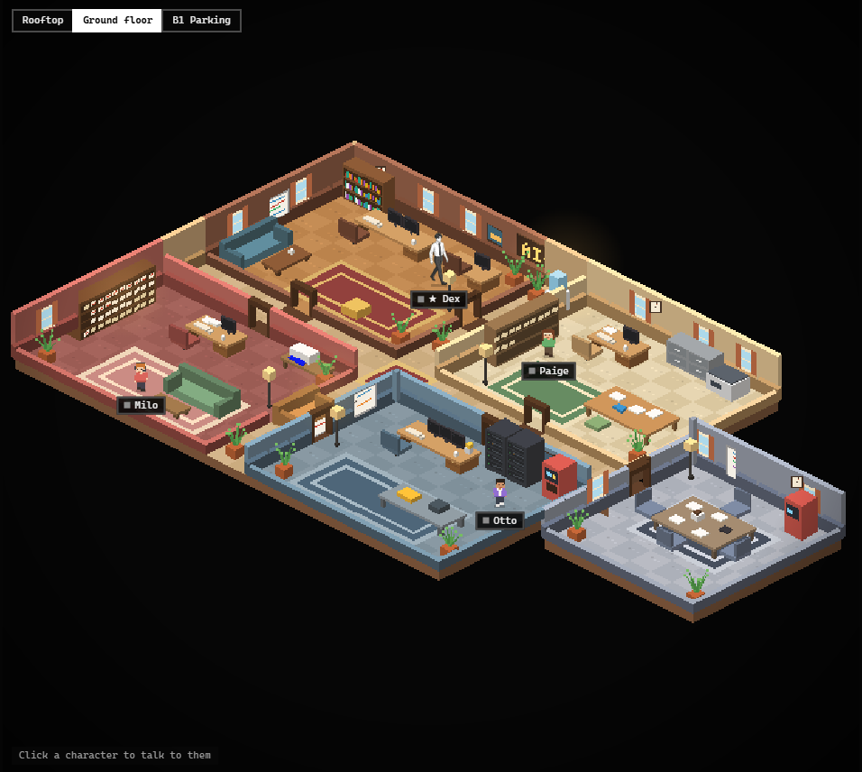
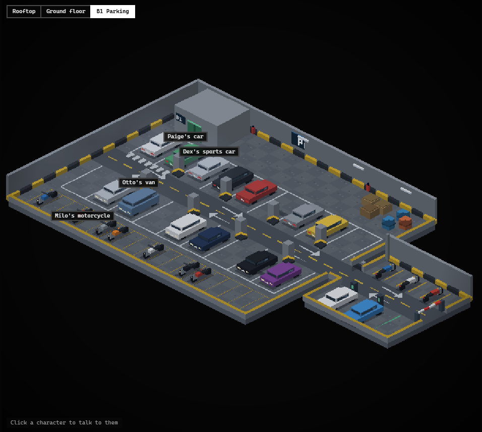
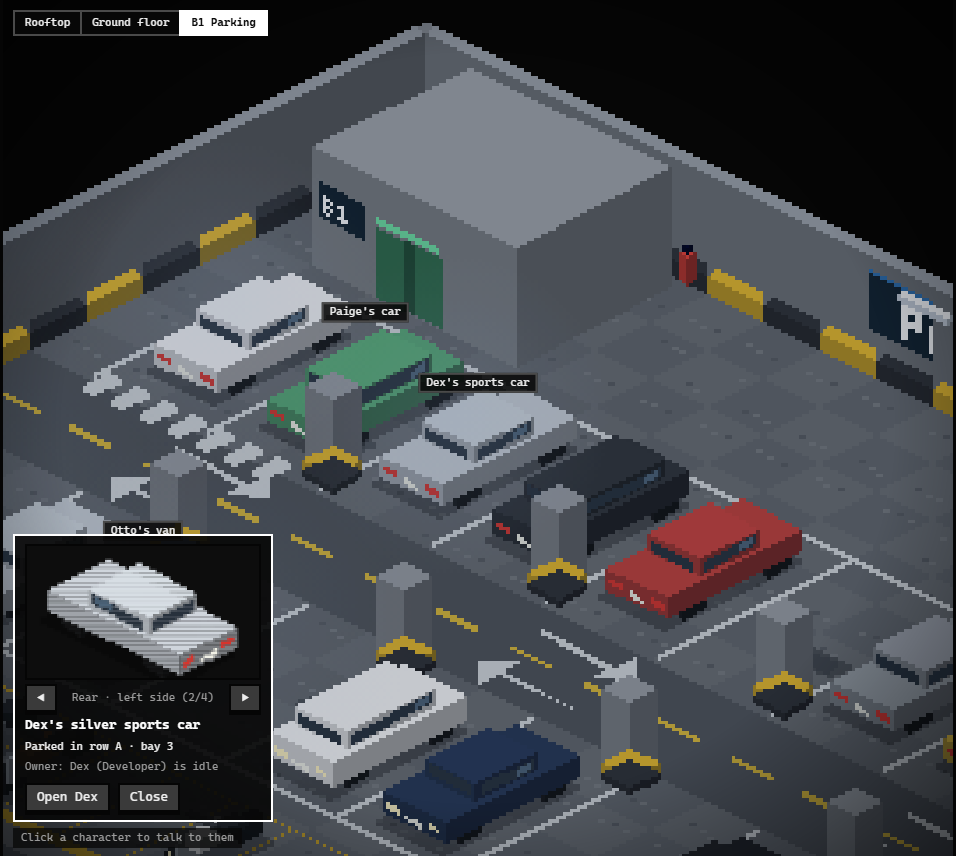

# ai-office

> **Beta version (v0.1).** This project is a work in progress. It runs and is usable every day, but expect rough edges, missing pieces and changes. **Download it and make it yours:** change the agents, the instructions, the art and the office layout to suit you. See [Make it yours](#make-it-yours).
>
> ⭐ **Don't forget the star!** If you like it, click **Star** at the top of the GitHub page. It helps a lot.

A locally hosted AI agent workspace shown as a retro isometric office. Each character is an AI agent powered by **your own Ollama model**. Everything runs on your PC: no cloud APIs, no Docker, no accounts.

- Four agents with their own desks, chat, instructions and task queue: **Dex** (Developer, and the boss), **Paige** (Documents), **Milo** (Email) and **Otto** (Automation).
- **Statuses are real.** An agent shows *Working* only while a real Ollama request is running. Nothing is faked.
- Works as an office dashboard even when Ollama is offline.
- Three floors to explore: a rooftop (garden, pool, basketball court), the office, and a basement car park.

## Current features (beta)

**Agents**
- Four agents, each with its own desk, system instructions and model (change them in the Profile tab, saved in SQLite).
- Streaming chat with each agent. Stop a reply, or pause an agent.
- Live statuses taken from real activity: Idle, Working, Waiting for approval, Error, Paused, plus the current task.
- If Ollama is offline the office still works, and the app tells you clearly.

**Tasks and approvals**
- A task queue per agent with history saved in SQLite.
- Email and Automation results wait for your **Approve / Reject**. Approving only marks the result; nothing is sent or run.

**Email (Milo)**
- Read-only inbox over IMAP (nothing is marked read, moved, deleted or sent).
- Summarise a mail, draft a reply, or triage the latest 10.

**Dex the boss**
- **Check on staff:** Dex walks to each desk and reviews the real data about each agent.
- **Hold meeting:** everyone sits in the meeting room, each agent reports, and Dex writes minutes with action items.
- Works from the Team tab or from plain chat ("check your team", "hold a meeting"). Meetings are saved in SQLite.

**The office**
- Isometric pixel-art office drawn procedurally, with desks, rooms, doorways and a meeting room.
- Characters walk between rooms, sit at their desk while working, stand with a raised hand when they need approval, and fidget while idle.
- Click a character to zoom to them. Optional 2D character art (included for Dex); the others use built-in pixel characters.
- Windows follow the real clock (day, dusk, night).

**Three floors**
- **Rooftop:** garden, swimming pool and a basketball half-court.
- **Ground floor:** the four departments plus the meeting room.
- **B1 Parking:** car bays, motorcycle zone and EV charging.
- Each agent owns a vehicle that **drives out while that agent is really working** and returns to a random free bay. Visitor cars come and go as background scenery only.
- Click any vehicle for a card with its live state, and turn it around in a small viewer.

**Look and privacy**
- Black, grey and white website theme. The B&W / Colour button changes only the office picture.
- Local only: listens on `127.0.0.1`, no cloud calls, no telemetry. Credentials stay on the server.

### Known limits (beta)
- Windows 11 is the only system it has been tested on.
- Sending email is not implemented. PDF processing and n8n workflows are placeholders.
- Approving a result only marks it approved.
- The default 3B model is small: its answers can be vague or wrong. Use a bigger model for better quality.
- Agents stay on the ground floor. The rooftop and garage are scenery, apart from the vehicles that follow agent status.
- Single user, no login (it is meant to run on your own PC).
- Vehicle artwork is not included; Dex's car is a plain box car until you add your own.

> **Built and tested on this PC:** Windows 11 Home, Intel Core i5-12400, 16 GB RAM, integrated Intel graphics (no dedicated GPU), Node 22, Ollama with `qwen2.5-coder:3b`.
> That is a modest machine, so the app is built to stay light: the office is drawn on a small canvas at about 30 fps, there is no database server, and the only AI load is the one local model. It uses only Node, Express and SQLite, so it should run on other systems too, but only Windows has been tested.

---

## Screenshots

**The whole app:** agent list on the left, the office in the middle, and the selected agent (here Dex's Team tab with staff-check notes) on the right.



### The three floors

| Rooftop | Ground floor | B1 Parking |
|---|---|---|
|  |  |  |
| Garden, swimming pool and a basketball half-court. | Development, Documents, Email and Automation, plus the meeting room. | Car bays, motorcycle zone and EV charging. Vehicles drive out while their owner is working. |

### Inspect a vehicle

Click any vehicle in the garage to zoom to it and turn it around. This is Dex's car, one of four views.



---

## 1. Requirements

| What | Version |
|---|---|
| Node.js | 22.13 or newer (uses the built-in `node:sqlite`) |
| Ollama | any recent version, running locally |
| A model | `qwen2.5-coder:3b` by default (any chat model works) |

Install the model once:

```powershell
ollama pull qwen2.5-coder:3b
```

## 2. Install and run

```powershell
git clone <your-repo-url> ai-office
cd ai-office
npm install
npm start
```

Open **http://localhost:3000**.

- `npm run dev` restarts the server when you edit files.
- Ollama must be running (`ollama serve`, or the Ollama desktop app). If it isn't, the top bar says *Ollama offline* and the office still works.
- The database is created on first run in `data/ai-office.db`.

### Optional settings

Copy `.env.example` to `.env` and change what you need. Every value is optional.

| Variable | Default | Meaning |
|---|---|---|
| `HOST` | `127.0.0.1` | Address to listen on. Keep it local. |
| `PORT` | `3000` | Web port |
| `OLLAMA_URL` | `http://localhost:11434` | Where Ollama runs |
| `OLLAMA_MODEL` | `qwen2.5-coder:3b` | Default model (each agent can override it) |
| `OLLAMA_KEEP_ALIVE` | `5m` | How long Ollama keeps the model in memory |
| `OLLAMA_NUM_CTX` | `4096` | Context window |
| `DB_PATH` | `data/ai-office.db` | SQLite file |
| `IMAP_HOST` / `IMAP_PORT` / `IMAP_USER` / `IMAP_PASS` | empty | Read-only inbox for Milo (see below) |

---

## 3. How to use it

### The screen

- **Top bar:** logo, how many agents are working, Ollama and SQLite status, the B&W/Colour button, and the clock.
- **Left panel:** the four agents with their live status and current task.
- **Centre:** the isometric office. Floor switcher at the top-left, zoom button at the bottom-right.
- **Right panel:** details for the selected agent (Chat, Team, Tasks, Profile and, for Milo, Inbox).

### Talk to an agent

1. Click a character in the office, or a name in the left list. The camera zooms to them.
2. **Chat** tab: type a message and press Enter. The reply streams in live. Use **Stop** to cancel, **Pause** to hold the agent.
3. **Esc** or the "Whole office" button zooms back out.

### Give an agent a task

1. Open the **Tasks** tab, describe the task and submit.
2. Tasks queue per agent. The character walks to their desk and types while the task really runs.
3. **Email and Automation** results wait for your decision: **Approve** or **Reject**. Approving only marks the result approved. Nothing is sent or executed.
4. The task history is stored in SQLite and stays after a restart.

### Change an agent

**Profile** tab: pick the model for that agent and edit its system instructions. Saved in SQLite.

### Statuses

| Status | Means |
|---|---|
| Idle | Nothing running. The character wanders and fidgets (coffee, stretching, thinking...). |
| Working | A real Ollama request is in progress. The character sits at the desk and the screen lights up. |
| Waiting for approval | A finished task needs your decision. The character stands with a raised hand. |
| Error | The last request failed (for example Ollama went offline). |
| Paused | You paused the agent. |

### Read your inbox (Milo)

Milo's **Inbox** tab shows your latest 10 emails, **read-only**: nothing is marked read, moved, deleted or sent. Add to `.env` and restart:

```
IMAP_HOST=imap.gmail.com
IMAP_USER=you@example.com
IMAP_PASS=your-app-password
```

Gmail and Outlook need IMAP turned on and an **app password**, not your normal password. Credentials stay on the server and are never sent to the browser. From the tab you can **Summarise**, **Draft reply** or **Triage inbox**. These become tasks for Milo, and drafts wait for your approval. Sending email is not implemented: copy the draft into your mail client.

### Let Dex run the team

Dex is the boss. Open his **Team** tab, or just tell him in chat: *"check your team"* or *"hold a meeting"*.

- **Check on staff:** Dex walks to each person's desk and reviews the real data about them (status, current task, queue, recent tasks), then writes review notes.
- **Hold meeting:** everyone walks to the meeting room on the east side and sits at the table. Each agent gives a short update from their own real data, then Dex writes minutes with action items. Busy or paused agents are not interrupted; they are reported as unavailable.
- **Stop** cancels it. Meetings and minutes are saved and listed under *Earlier*.

### Explore the floors

Use the switcher at the top-left of the office:

- **Rooftop:** garden, swimming pool and a basketball half-court. Lamps and pool glow turn on at dusk and night, following your real clock.
- **Ground floor:** the four departments, the corridor and the meeting room.
- **B1 Parking:** a garage with car bays, a motorcycle zone and EV charging.

In the garage, each agent owns a vehicle: Dex's sports car, Paige's car, Otto's van and Milo's motorcycle. A vehicle **drives out while its owner is really working** and drives back to a random free bay afterwards. A few visitor cars come and go as background traffic only (decorative).

**Click a vehicle** to zoom to it and open its card: what it is, whether it is parked, driving or out, which bay, and the owner's live status. Turn the preview with ◀ ▶ (or the arrow keys). Vehicles have four views (the diagonals). If you add your own artwork for Dex's car (see *Optional vehicle artwork* below) it gets nine: the diagonals plus front, rear, both sides and top.

### Look

- **B&W / Colour** button (top bar) switches the office picture between black-and-white and colour. The website itself is always black, grey and white.

---

## 4. Customise

### Your own character art

Characters are drawn with 2D art when files exist, and fall back to pixel characters otherwise. Put one transparent PNG per pose in `public/assets/chars/`, named `<name>-<pose>.png`, where `<name>` is `dex`, `paige`, `milo` or `otto`:

`stand`, `walk1`, `walk2`, `sit`, `alert`, `drink`, `hold`, `stretch`, `think`, `watch`, `yawn`.

Generated sheets on a solid green (#00FF00) background can be cut automatically (needs Python 3 with `pillow`, `numpy` and `scipy`):

```powershell
pip install pillow numpy scipy
python tools/slice-sheet.py public/assets/dex-basic-poses.jfif dex 160
python tools/slice-sheet.py public/assets/dex-idle-poses.jfif dex 156 drink,hold,stretch,think,watch,yawn 3
```

For vehicles: `tools/slice-vehicle.py` (3/4 views) and `tools/slice-flat.py` (side, front, rear, top). Results go in `public/assets/vehicles/`.

### Sample assets

These are the art files the app uses (all transparent PNGs, generated and then cut from green-screen sheets).

**Dex's character poses:** standing, two walking frames, sitting at the desk, hand raised (waiting for approval), and the idle fidgets that only play while he really is idle.


### Optional vehicle artwork (not included)

Dex's car is drawn as a plain silver box car by default. To use your own 2D artwork instead, put transparent PNGs in `public/assets/vehicles/` (this folder is git-ignored, so your art stays on your machine):

| File | View |
|---|---|
| `sportscar-rear.png` | 3/4 view from the rear-right |
| `sportscar-front.png` | 3/4 view from the front-right |
| `sportscar-flat-side.png`, `-flat-front.png`, `-flat-rear.png`, `-flat-top.png` | flat side, front, rear and top views |

All six files are needed; if any is missing the app falls back to the box car. Make sure you have the right to use any artwork you add, and do not publish artwork of real brands or models you do not have permission for. The cutting scripts `tools/slice-vehicle.py` and `tools/slice-flat.py` turn green-screen sheets into these files.

### Add or change agents

Agents live in the `agents` table (seeded in `server/database/seed.js`) and need a desk in `public/js/scene.js` (`STATIONS`, `ROOMS`). The boss is set by `BOSS_ID` in `server/services/agents.js`.

### Connect more tools

`server/services/integrations.js` lists PDF extraction, email sending and n8n workflows as planned. Implement `run()` there and the UI shows the real status.

---

## Make it yours

This is a beta and it is meant to be changed. Download it and shape it into your own office:

1. **Get it:** click **Code → Download ZIP** on GitHub, or fork the repository and clone your fork.
2. **Run it** with the steps in *Install and run* above.
3. **Rename and retrain your agents:** open each agent's **Profile** tab and rewrite its system instructions, or change the names and roles in `server/database/seed.js`.
4. **Use your own models:** pick a different model per agent (any model installed in Ollama).
5. **Draw your own characters and cars:** drop your own PNGs into `public/assets/` (see *Customise*).
6. **Rebuild the office:** rooms, furniture, the rooftop and the garage are all code in `public/js/scene.js`, `roof.js` and `basement.js`.
7. **Plug in your tools:** add real integrations in `server/services/integrations.js`.

Found a bug or built something nice? Issues and pull requests are welcome.

⭐ **Enjoying ai-office? Don't forget the star!**

---

## 5. How it works

```
server/   Express API, SQLite (node:sqlite), Ollama client, agent runtime, meetings
public/   Plain HTML/CSS/JS. The office is drawn procedurally on a low-resolution canvas
data/     ai-office.db (created on first run, git-ignored)
tools/    Optional scripts that cut generated art sheets
```

- `server/services/agents.js` is the single source of truth for status. It derives it from real activity: a busy request, a pause, an error or a task waiting for approval.
- The browser gets live updates over Server-Sent Events. Characters are a state machine driven by those real statuses.
- Chat streams from Ollama's `POST /api/chat`.
- Only three npm dependencies: `express`, `imapflow` and `mailparser`.

### Safety

- The server listens on `127.0.0.1` only, checks the Host header (DNS-rebinding guard) and blocks cross-origin writes.
- Email content is passed to the model as untrusted data.
- Email is read-only and nothing is sent automatically. Every Email/Automation result needs your approval.

---

## 6. Troubleshooting

| Problem | Fix |
|---|---|
| *Ollama offline* in the top bar | Start Ollama (`ollama serve`). Check `OLLAMA_URL`. |
| *Model missing* | `ollama pull qwen2.5-coder:3b`, or choose another model in the agent's Profile tab. |
| Page looks old after an update | Hard refresh with Ctrl+F5. |
| `EADDRINUSE` on start | Another copy is running on that port. Stop it or change `PORT`. |
| Inbox says *not connected* | Add `IMAP_*` to `.env` (use an app password) and restart. |
| `node:sqlite` errors | Update Node to 22.13 or newer. |
| Slow replies | Use a smaller model, or lower `OLLAMA_NUM_CTX`. |

Stop the server with Ctrl+C. On Windows, if it was started in the background:

```powershell
Get-NetTCPConnection -LocalPort 3000 -State Listen | ForEach-Object { Stop-Process -Id $_.OwningProcess -Force }
```
